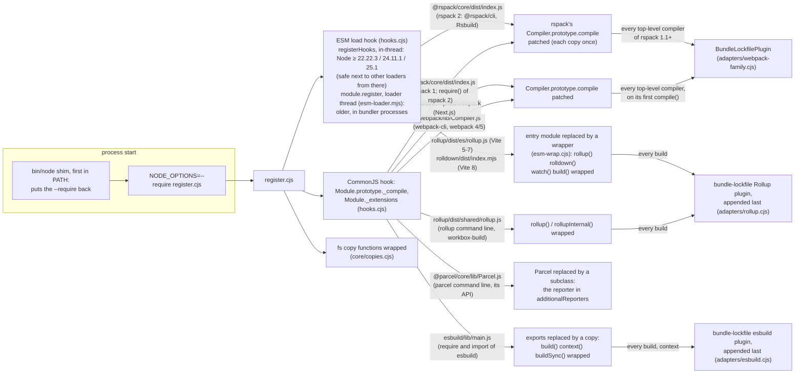
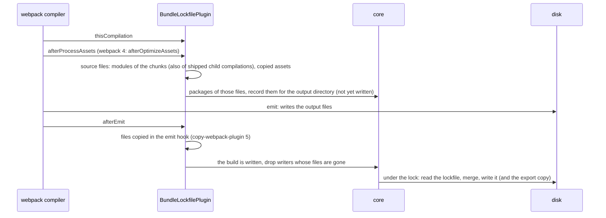
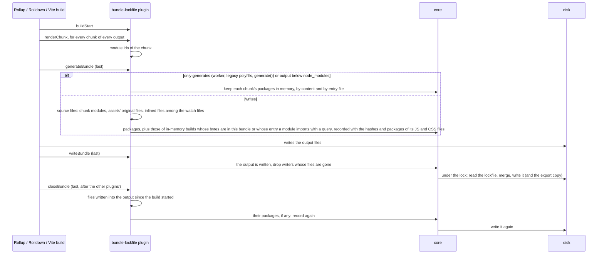
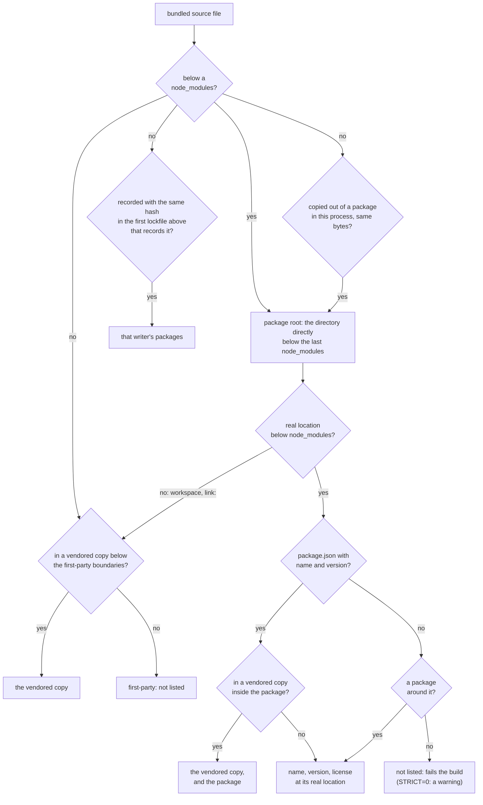
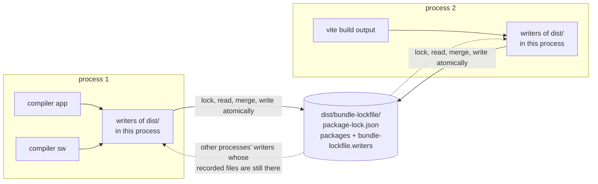
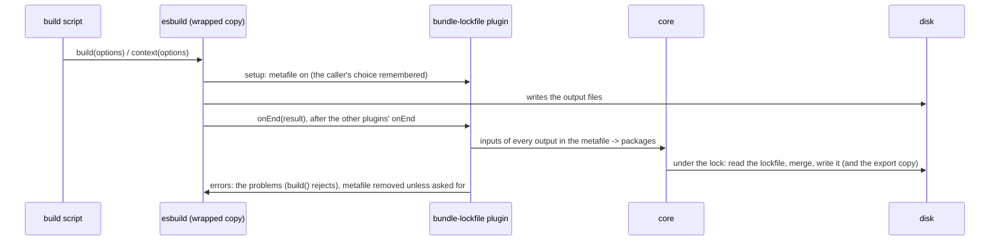

# How bundle-lockfile works

For maintainers. What gets listed, and how to use it, is in the [README](../README.md); the lockfile format is in
[format.md](format.md).

## Getting into the build

`register.cjs`, preloaded with `--require`, runs before the build tool's own code. It installs a hook on
`Module.prototype._compile` and the CommonJS module handlers (`Module._extensions['.js']`, `['.cjs']`): every CommonJS
module once it has run, also one another loader compiles itself (tsx's handler for `.js` files does, without the
handler before it); not `Module._load`, whose wrapper would be the caller of every built-in module for Node's
deprecation warnings and, depending on the
Node.js version (see [Vite, Rollup, Rolldown](#vite-rollup-rolldown)), an ESM load hook. Each recognizes a bundler's
module when it is loaded and patches it so that every build gets bundle-lockfile's plugin — without a config change.
Modules that ran before the hook was installed (loaded by an earlier preload) are looked at when it is.
`module.registerHooks`' load hook alone would not do: it sees `require()` too (with the source, and `format`
undefined for a required module), but not a module that a `Module._extensions` handler reads and compiles itself, as
tsx's does: under tsx 4.23 (`tsx` and `node --import tsx`) the resolve hook runs for a bundler's file, its load hook
never - tried on Node.js 22.23, 24.22 and 26.12 (2026-10-15).



## What a build does

Both plugins answer the same question — which source files are in the output this build writes? — and hand the files
to the core, which turns them into packages and the lockfile.



(This is the real disk; with an in-memory output file system the lockfile is a webpack asset, added in
`afterProcessAssets`, and written again in `afterEmit` only if other writers share it or files were copied in the emit
hook; the export copy is written after every build. An output directory on disk that another plugin removed after
the build, in its own `afterEmit`, is not created again for the lockfile: only the export copy is written, and the
lock is taken next to it.)



## From files to packages



A file outside `node_modules` that is neither a copy, nor recorded by another build, nor in a vendored copy is
first-party and not listed (see [format.md](format.md#which-package-a-file-belongs-to) for what a vendored copy is and
where the first-party boundaries are; `src/core/vendored.cjs`). Vite, Rollup and Rolldown builds add the packages of
builds that write nothing themselves by the content of their chunks (see [coverage.md](coverage.md)).

## One lockfile, several writers



Within a process, the writers of an output directory live in a registry shared by every copy of bundle-lockfile that
is loaded (on `globalThis`); each has the packages of its last written build and of the build in progress. Every write
of the lockfile renders their last written builds, plus the writers other processes recorded in the lockfile on disk.
Every adapter ends a written build the same way, `outputs.land()`: the other writers whose files are gone are dropped,
then the lockfile is written under the lock - writes of one lockfile in this process one after another, across
processes one at a time; a process waiting for the lock goes on running its event loop (a dev server, other compilers).

## Beyond the chunks' modules

Besides the modules of the written chunks, a lockfile lists the packages of:

- **webpack and rspack child compilations whose output is shipped**: emitted next to the bundle (workers built by
  `worker-loader` or monaco-editor-webpack-plugin, workbox's `InjectManifest` service worker) or inlined into a
  bundled module (`worker-loader`'s `inline: 'no-fallback'`). Child compilations that only run at build time
  (html-webpack-plugin's template, mini-css-extract-plugin's loader, vanilla-extract's compiler) are not counted.
- **assets with the bytes of a build that writes nothing itself** (webpack, rspack): workbox-webpack-plugin's
  `GenerateSW` generates `sw.js` and `workbox-<hash>.js` with workbox-build (Rollup's `generate()`, hooked) and emits
  them as assets, in `processAssets` (webpack 5) or in the emit hook (webpack 4: looked at once the output is written).
- **files copied verbatim into a webpack output**, e.g. by `copy-webpack-plugin`, whose assets record the file they
  were copied from (`info.sourceFilename`, from 6.3 on). Those of copy-webpack-plugin 5 (webpack 4, in the emit hook,
  after the lockfile) and 6.0 – 6.2 (before it) do not: such a file counts as the package file with the same bytes
  that the compilation depends on — a file dependency, or a file below a context dependency in `node_modules` (6.2
  adds a copied directory only as one). webpack 5 minimizes such copies like other assets, so they are matched just
  before its optimize stages. An asset that is a chunk's or a module's file is no copy; a copy that was transformed
  before that matches none. rspack's CopyRspackPlugin records its source differently, see [rspack](#rspack).
- **builds that write nothing themselves** (Vite, Rollup, Rolldown): Vite's worker bundles (emitted as files of the
  main build, or inlined with `?worker&inline`), @vitejs/plugin-legacy's polyfills, workbox-build's service worker
  (vite-plugin-pwa), any build that only generates (Rollup's and Rolldown's `generate()`, Vite's `build.write:
  false`). Their chunks' packages are kept in memory, in the process, and listed where the same bytes end up in a
  written output (a chunk or JavaScript asset with that content), or where a module imports the build's entry file
  with a query (`?worker&inline`). So are the package files their assets were emitted from (a worker's font), by the
  asset's bytes: the main build emits them again without naming the file. Such a build that names where its output
  goes (Rollup's `generate()` with `dir` or `file`, esbuild's `write: false` with `outdir` or `outfile`) leaves that
  path in `core/generated.cjs` (`addDestined`): a file there when the process ends that no lockfile of the process
  lists and that was written after the build (as built, or changed) was written by the caller (tsup), and is a
  problem. A build that only looks at its output, or whose output another build emits (Vite's workers and polyfills,
  whose files the main build lists), leaves nothing new there.
- **files a loader or plugin inlines into a module** (style sheets a style sheet `@import`s, images and fonts it
  inlines as `data:` URLs, a shader's `#include`s, JSON merged in): no modules, recorded only by the loader or plugin
  that read them. A recorded file counts if it is no code and no build tool's settings by its name
  (`packages.inlinedFile`: not `.js`, `.ts`, `.d.ts`, `.vue`, ..., not `package.json`, `tsconfig*.json`, `.babelrc`,
  `.browserslistrc`, ...; JSON other than that counts).
  - In Vite, Rollup and Rolldown builds: such files among the build's watch files (`this.addWatchFile`; Vite's CSS
    plugin adds what a style sheet `@import`s, from Vite 6.1 on also the files its `url()`s inline) that are no module
    of the build - not even one that was tree-shaken.
  - Rollup records a build's watch files only from the modules it transforms: a rebuild in watch mode takes unchanged
    modules from the previous build's cache, without adding their transform dependencies. The plugin reads the
    cache's modules' `transformDependencies` in its `options` hook (Rollup drops the cache before `buildStart`) and
    takes them for the modules its own `transform` hook did not see in this build.
  - Rolldown provides the watch files only on the build object `rolldown()` returns, not to its plugins (no
    `getWatchFiles`, rolldown#819), and its `build()` and `watch()` functions — which `vite build --watch` on Vite 8
    calls — not at all. So `adapters/rolldown-watch.cjs` wraps `addWatchFile` on Rolldown's plugin context classes
    (`PluginContextImpl`, and its subclasses for the load and transform hooks, each with its own `addWatchFile`): the
    plugin meets an instance of each in its own `buildStart`, `load` and `transform` hooks (`order: 'pre'`, before
    Vite's CSS plugin) and wraps the method of the prototype that has it, once per copy of Rolldown. Each call is
    recorded for the build whose `data` the context has (one per build, shared by all plugins' contexts) and the module
    it is made for (`moduleId`, `currentLoadingModule`; none: the whole build's); a module's records start over when
    it is loaded again. An output takes the records of its chunks' modules and those of no module, and the build's
    watch files where `rolldown()` returned them. A Rolldown build with style (style modules, CSS files) with neither
    is a problem: its style sheets `@import`ed from packages would be missing.
  - In webpack and rspack builds: such files among the file dependencies of a shipped module, which its loaders
    record (`this.addDependency`): Sass partials (sass-loader), Less `@import`s (less-loader), postcss-import's and
    Tailwind's style sheets (postcss-loader) - of a style sheet, and of any module whose loaders compile style (a Vue
    single-file component's `<style lang="scss">`, `App.vue?vue&type=style`, whose file is `App.vue`; an Angular
    component's styles) -, glslify-loader's includes, a style module's images and fonts (what its CSS embeds as
    `data:` URLs, from asset modules mini-css-extract-plugin builds at build time, in no chunk). A style module that
    recorded no file dependencies at all (rspack before 1.3.14; webpack 5 when its snapshot failed) lists every
    style sheet below `node_modules` among the compilation's file dependencies.
- **files other plugins write into the output after the build** (Vite, Rollup, Rolldown: in a `closeBundle` hook that
  runs before bundle-lockfile's; webpack and rspack on the real disk: in an `afterEmit` hook that runs before
  bundle-lockfile's, or in the emit hook): JavaScript files with the bytes of a chunk of a build that writes nothing
  itself (vite-plugin-pwa's `sw.js` and `workbox-<hash>.js`), and copies of package files (vite-plugin-static-copy,
  filemanager-webpack-plugin); see [below](#files-written-after-the-build).
- **copies out of packages** (every bundler): `fs.copyFile`, `fs.copyFileSync`, `fs.cp`, `fs.cpSync` and their
  `fs.promises` versions are wrapped to remember, in the process, which file in `node_modules` a file outside of it
  was copied from (fs-extra and graceful-fs call them, so their copies count). A bundled file, or one written into an
  output after the build, that still has the bytes of its source lists the source's package. A file written into an
  output after the build by another process counts if its path in the output contains `node_modules/<package>/` and
  it has the bytes of that package's file there.
- **nested bundles**: a bundled file outside `node_modules` that another Vite, Rollup or Rolldown build wrote, e.g.
  GitLab's Vite-built "island" `ee/frontend_islands/apps/duo_next/dist/main.js` (Vue inlined), which webpack bundles
  as part of its own code. See [format.md](format.md#nested-bundles).

### Files written after the build

A Vite, Rollup or Rolldown build looks at its output directories again in its `closeBundle` hook, which runs after the
other plugins' (vite-plugin-pwa writes `sw.js` in its own). Rollup runs `closeBundle` on `bundle.close()`, Vite after
the write; a programmatic build that never closes its bundle keeps the lockfile written after its output. Rolldown
runs `buildStart` again for every `write()` of a build: the outputs of all of them are looked at, until it is closed.
A webpack or rspack compiler writing to the real disk looks at its output directory in its `afterEmit` hook, which
runs after the other plugins' (`core/late.cjs`, shared by both).
- Only files modified since 2 s before the build started count (for coarse file-system timestamps).
- At most 20,000 entries of the output directory are looked at (with more: a warning).
- (In the whole process, at most 50,000 files copied out of packages and 10,000 chunks of builds that write nothing
  themselves are remembered: with more, the oldest are forgotten, with a warning.)
- Files over 20 MiB are compared only if this process copied them with fs (one whose path in the output names a
  package: a warning).
- An output directory that contains the working directory is not looked at.

## Vite, Rollup, Rolldown

Vite imports Rollup (5–7) and Rolldown (8) as ES modules, which the CommonJS hook does not see. An ESM hook therefore
replaces their entry modules (`rollup/dist/es/rollup.js`, `@rollup/wasm-node/dist/es/rollup.js`,
`rolldown/dist/index.mjs`) with a wrapper that re-exports everything and wraps `rollup()`, `rolldown()`, `watch()` and
`build()`. Rollup's CommonJS build is patched when it loads (`require('rollup')`, the `rollup` command line,
workbox-build). Either way every call gets one more plugin, last, unless it has one already. That plugin records the
modules of every chunk when it is rendered (also of chunks a plugin removes later, e.g. vite-plugin-singlefile) and
writes the lockfile after the output is written. `vite dev`, `vite preview` and Vitest write no lockfile: they build
nothing with Rollup or Rolldown that ships. Vite 8's dependency pre-bundling is a Rolldown build into Vite's cache
directory (`node_modules/.vite`, or the config's `cacheDir`, also outside `node_modules`): recognized by its plugin
(`vite:dep-pre-bundle`), it gets none. Vite 5–7 pre-bundle with esbuild.

The wrapper of an entry module wraps every function the adapter names, whether the module's source shows it (the
namespace also has what an `export *` brings) or not, and reports whether the module had any of them: an entry with
none is a version the adapter does not know, which fails its import in strict mode (`hooks.cjs` `found`). The real
module is imported as `<url>?bundle-lockfile-real`: its `import.meta.url` has that query, which Node drops when it
makes a path (`fileURLToPath`, `import.meta.filename`, `createRequire`, `new URL('./x', import.meta.url)`). A module
of the bundler's own graph that imported the entry back would get the wrapper, whose exports exist only once the real
module has run (read before, they throw); none of the wrapped entries has such a cycle (rollup 4.64, rolldown 1.2,
@rspack/core 2.2). Paths are
recognized as if every package were at `node_modules/<name>` (`core/layout.cjs`: Yarn's pnpm linker puts packages in
`node_modules/.store/<slug>/package/`).

### Which ESM hook

The ESM hook depends on the Node.js version (`BUNDLE_LOCKFILE_ESM_HOOKS` overrides it):
- Node.js 22.22.3 and later 22.x, 24.11.1 and later 24.x, 25.1 and later (not 23.x): `module.registerHooks`, in the same
  thread, in every process. Before those versions, in-thread hooks fail next to a loader-thread hook (Yarn
  Plug'n'Play's, tsx's, OpenTelemetry's `hook.mjs`) that provides no source for a CommonJS module, which Node then reads
  itself: they reject it (`ERR_INVALID_RETURN_PROPERTY_VALUE`; fixed by
  [nodejs/node#59929](https://github.com/nodejs/node/pull/59929)). `module.registerHooks` called in Node's own loader
  thread - by a `--require` preload, which Node 22 – 24.11 runs there too - crashes the process
  ("this[#customizations].loadSync is not a function"): `register.cjs` does nothing there.
- Older versions with `module.register` (18.19, 20.6 and later): a loader thread, only in processes whose main script
  belongs to a package that is or depends on `vite`, `rollup`, `rolldown`, `rolldown-vite`, `@rspack/core`,
  `@rspack/cli` or `@rsbuild/core` (the adapters' `esmPackages`) — the `vite`, `rspack` or `rsbuild` command, a build
  script of a project using one of them, tools such as `headlamp-plugin` —, whose project has one of them installed
  (`node_modules/<package>` in the working directory or above, also pnpm's and bun's `node_modules/.pnpm/node_modules/`,
  `node_modules/.bun/node_modules/`: `nuxi`, `storybook`, which load their bundler through a dependency), or that have
  another loader-thread hook (`--experimental-loader`, `--loader` or `--import` in `NODE_OPTIONS` or on the command
  line, e.g. Yarn Plug'n'Play's, see below), because a loader thread costs time and memory in every process. Also in
  each worker thread of such a process, which gets a loader thread of its own: the main thread's `module.register()`
  hooks do not reach a worker, which runs the `--require` preload again
  ([nodejs/node#52706](https://github.com/nodejs/node/pull/52706), which shared them, was reverted).
- Node.js 20.0 – 20.5 have neither: a process that would get the loader thread has a problem (its ES-module bundlers
  would write no lockfile).
- A thread without ESM hooks (they are not turned off, but the process was not taken for a bundler process) has a safety
  net: each ES-module bundler loads a CommonJS file of its own (the adapters' `esmCompanions`: Rollup's
  `dist/native.js`, Rolldown's binding package's `package.json` and `.node` file, rspack 2's `@rspack/binding`), from a
  module that did not come through the CommonJS hook; its CommonJS build loads the same file from one that did. Loading
  it there is a problem: in strict mode the bundler's import fails, with `BUNDLE_LOCKFILE_ESM_HOOKS=async` as the fix.
- `BUNDLE_LOCKFILE_ESM_HOOKS=async` uses the loader thread in every process and worker thread, `sync` the in-thread
  hooks wherever `module.registerHooks` exists (also on versions where they are not safe next to other loaders),
  `off` neither. Node.js's own loader thread, which runs `--require` preloads too, never gets them: `register.cjs`
  does nothing there. Node.js 22.14 and later mark it (`isInternalThread`); before, it is the thread that is neither
  the main thread nor a user's worker, which always has a `parentPort`. Settings problems are reported by each
  process's main thread.

### CommonJS modules a loader hook provides

Node.js loads a CommonJS module without its module handlers (`Module._extensions`) — and everything that module
`require()`s — when a loader-thread hook provided its source. Only the ESM hooks see such modules.

Yarn Plug'n'Play's loader does this for the files in its zip cache on Node.js 22.22.3+, 24.15+, 25.7+ and 26.x
([yarnpkg/berry#7070](https://github.com/yarnpkg/berry/pull/7070), extended to 24.15 by #7104 and to 22.22.3 by
#7141). It works around an
`fstat` failure on its file descriptors that came with [nodejs/node#61769](https://github.com/nodejs/node/pull/61769)
and related loader changes, fixed by [nodejs/node#62835](https://github.com/nodejs/node/pull/62835) in 22.23.3, 24.16
and 26.1; Yarn keeps providing the source on those versions. There, webpack, Next.js' webpack and Rollup's CommonJS
build and rspack 1 would not be hooked: webpack-cli 7 `import()`s webpack, and on Node.js 22 Plug'n'Play loads even
the main script that way.

So for the files the adapters patch (`cjsFiles`: webpack's `Compiler`, Next.js' webpack, Rollup's CommonJS build,
rspack 1's `@rspack/core/dist/index.js`), the
ESM hook appends a line to a provided source that reports the module once it has run, as the CommonJS hook would. Other
modules and sources are left as they are. A loader-thread hook registered after bundle-lockfile's (an `--import` after
the `--require`) that provides the source without calling the next hook hides it.

## rspack

rspack implements webpack's plugin API, so its compilers get webpack's `BundleLockfilePlugin`
(`src/adapters/webpack-family.cjs`); where rspack differs, `src/adapters/webpack-compat.cjs` tells their compilations
apart (`compiler.webpack.rspackVersion`) and answers for each. `src/adapters/rspack.cjs` only hooks rspack:

- `@rspack/core` is one bundled file, `dist/index.js`: no per-file module to recognize (as webpack's
  `lib/Compiler.js`). Its export is the `rspack()` function with `rspackVersion` and `Compiler` (its `version` is
  always `5.75.0`, the webpack API it implements). rspack 1's file is CommonJS: `require()` and `import()` of it go
  through the CommonJS hook (onCjsLoad), and under Yarn Plug'n'Play on recent Node.js versions through the line
  `cjsSource` appends (`cjsFiles`). rspack 2's is an ES module: `@rspack/cli` 2 and Rsbuild 2 `import` it, which only
  the ESM hook sees (`esmEntries`; its wrapper wraps `Compiler`, and `esmWrap` patches the class); `require()` of it
  (require(esm), a CommonJS config) goes through the CommonJS hook too. Only ES modules are wrapped: rspack 1's file has
  the same path.
- Its `Compiler.prototype.compile` is patched as webpack's; rspack's Compiler has no `newCompilation`, so the
  webpack adapter does not take it (and refuses compilers that name an rspack version: Next.js with next-rspack
  assigns rspack's exports to its vendored webpack). A process can load several copies (OHIF: rspack 1 for the config's
  plugins, rspack 2 for the compiler) and see one copy on several paths (with the in-thread ESM hook, the ESM hook and
  the CommonJS hook): each class is patched once, marked on its prototype.
- rspack 1.0 has no inner modules of concatenated modules (`ConcatenatedModule.modules`, from 1.1) nor a module graph:
  the plugin, also one in the config, fails each of their compilations (`core/problems.cjs`) instead of collecting.
  rspack 0.x is not supported: a problem when one of its compilers compiles (or, of a shape bundle-lockfile does not
  know, when it loads).

Where rspack's compilations differ:

| | webpack | rspack |
|---|---|---|
| copies (copy-webpack-plugin / CopyRspackPlugin) | `info.sourceFilename`, relative to the context | relative to the copy pattern's context (a copied file: its name). The file dependencies whose path ends with that name are its candidates (the same file through several paths once); the one with the copy's bytes before the optimize stages (minimizers change copies) is its source, and a first-party source lists nothing; with none (a copy transformed on the way), the candidate at that name below the compiler's context (the pattern's default context), else every package file with that name. A name no file dependency has: the package file with the copy's bytes, as for copy-webpack-plugin 6.0 – 6.2 |
| style sheets loaders inline | in the module's `buildInfo` (`fileDependencies`, or its snapshot) | `buildInfo.fileDependencies` from 1.3.14; before, every style sheet below `node_modules` among the compilation's file dependencies |
| inlined constants (`optimization.inlineExports`) | webpack 5.108+: such a module is in no chunk, not listed | listed: modules in no chunk whose exports info says they are used (`isModuleUsed`), when the options inline exports (`optimization.inlineExports`; 1.4 – 1.6: `experiments.inlineConst` or `inlineEnum`, without which the parser option fails) and analyse their use (else every module counts as used); rspack 1.4 – 1.5.3 mark such modules unused: there every package module in no chunk (1.5.0 – 1.5.2 inline also without usage analysis); the options are read after rspack filled in its defaults |
| the match resource | `nameForCondition()` | the same from 1.7; before, `matchResource` is taken first |
| hooks | an unknown hook is `undefined` | rspack 2's hooks objects throw on reading an unknown hook: optional hooks are read with `in` first |
| `compilation.modules` | cheap | each module becomes a JavaScript object when read (about 45 µs and 20 KB each): read only where needed |
| output file system | webpack's (graceful-fs), Node's fs, or memfs | graceful-fs before 1.6, Node's fs after; dev servers swap in memfs when the compilation starts |

A compilation of rspack 2.2 is partly gone after the next watch rebuild (reading its modules throws): nothing keeps
one beyond its build.

## esbuild

esbuild's API is `lib/main.js` of the `esbuild` (or `esbuild-wasm`) package, CommonJS, also when a build script
`import`s it. Its exports are getters without setters (`__toCommonJS`), so the adapter cannot patch them: its
`onCjsLoad` returns `{ exports }`, a copy of every export with `build()`, `context()` and `buildSync()` wrapped, and the
CommonJS hook puts that copy in the module's place (`module.exports`, before any `require()` or `import` of it returns).
The copy's `default` is the copy: esbuild's own is its inner exports object, which code compiled with ES-module
interop (`__importDefault`) calls, and which would bypass the wrappers.



- `buildSync()` takes no plugins: it gets `metafile: true`, and its result is processed the same way after it returns.
- The other plugins of a build get, in their `setup`, a build object whose `onLoad` records the `watchFiles` of what
  they load (a Proxy of esbuild's: everything else is esbuild's own). The files among them a plugin inlines
  (`packages.inlinedFile`: no code, no build tool's settings) count for the module (by the metafile's key of it), if
  that module reaches an output: Sass partials that esbuild-sass-plugin inlines.
- The plugin's `onEnd` runs last: files the other plugins' `onEnd` wrote into the output since `onStart` are looked at
  as in `core/late.cjs` (a copy out of a package, also with fs's copy functions; a generate-only build's chunk).
- `bin/bundle-lockfile-from-metafile` writes the lockfile from a metafile file, with the same mapping and
  `core/outputs.cjs`, for the command line and the Go API.
- The input keys of a metafile are paths relative to `absWorkingDir`, with esbuild's own forms: `<namespace>:<path>`
  (a plugin's module: a file if the path is absolute, or relative and there), `(disabled):<path>` (a browser field's
  `false`: no code of it ships), `?query` and `#hash` suffixes. Every input of an output counts, also one without bytes
  in it (a module that only re-exports); a tree-shaken one is in no output.
- A build with `write: false` (or without `outdir` and `outfile`) writes nothing itself: its outputs' packages go to
  `core/generated.cjs`, by content and entry file, as for Rollup's `generate()`. Without `outdir` and `outfile` its one
  output file is `<stdout>` in `outputFiles` and named after the entry point in the metafile. The entry files count
  for a module of a later build whose contents a plugin gave (the recording `onLoad`), not its own entry point: a
  plugin that inlines a sub-build's output into the module it loads (esbuild-plugin-inline-worker).
- The default working directory is esbuild's own: `process.cwd()` when its `lib/main.js` ran (`var defaultWD`), taken
  in `onCjsLoad` and passed into the options as `absWorkingDir`.
- Vite 5 – 7 build with esbuild too: dependency pre-bundling and its scan (their plugins `vite:dep-pre-bundle`,
  `vite:dep-scan`), `vite.config.*` (`externalize-deps` with `inject-file-scope-variables`) and a dependency's entry for
  its exports (`extractExportsData`, with `optimizeDeps.extensions`: `write: false`, one entry point, the plugins of
  `optimizeDeps.esbuildOptions`, so told by its caller in the stack, a function of that name in Vite's `dist/node`):
  left alone.
- esbuild before 0.17 has no `context()` (rebuilds were `build({ incremental })`): a call that would write an output
  fails (strict mode) instead of writing no lockfile.

## Parcel

`@parcel/core` is Babel's CommonJS, one file per module; its `lib/index.js` re-exports `lib/Parcel.js`'s default
through a getter, read when the command line or a tool constructs a Parcel. The adapter replaces that default with a
subclass whose constructor adds the reporter to `additionalReporters`: the option Parcel's command line adds its own
reporters with, prepended to the config's reporters (`ParcelConfigRequest`), loaded in every process (not from
`.parcel-cache`). Parcel loads a plugin by its package name, here the absolute path of `src/adapters/parcel-reporter/`
(a `package.json` with `engines.parcel`; the plugin is the object at `Symbol.for('parcel-plugin-config')`, as
`@parcel/plugin` makes it), resolved from the project: Yarn Plug'n'Play's resolver resolves nothing from a directory
outside the project. Parcel requires the plugin's own modules through that resolver too, so the reporter reaches the
adapter through a global, not `require()`.

On `buildSuccess` the reporter goes through `bundleGraph.getBundles({ includeInline: true })`, per target directory,
and each bundle's `traverseAssets`. An asset the scope-hoisting packager skips - `sideEffects: false`, no used symbol
(`getUsedSymbols`), not referenced by the bundle (`isAssetReferenced`) - is left out, as Parcel's packager decides.
## Angular

`@angular/build/src/builders/application/execute-build.js` (and the copy in `@angular-devkit/build-angular` 17) exports
`executeBuild(options, context, rebuildState)`, which `buildApplicationInternal` calls through the module's exports for
every build and rebuild; it returns the build's `ExecutionResult` (output files, asset files, errors). The adapter
replaces that export with a wrapper that runs it with `stats: true`: Angular then adds its final metafiles (after the
chunk optimizer) as output files, `browser-stats.json` and `server-stats.json` (22), or one `stats.json` for both
(17 – 21). The wrapper reads them (and takes them out again unless the build asked for stats), maps their outputs'
inputs and the result's asset files (`assetFiles`, copies Angular makes, also from `node_modules`) to packages, renders
the lockfile with `core/outputs.cjs` and adds it with `addOutputFile`. Angular writes it; the export copy is written by
bundle-lockfile, only once the build is known not to fail (a problem in strict mode is an error of the result: Angular
writes none of its files).
- `executeBuild`'s second argument is the builder's context (Architect's `BuilderContext`): builds of the builders
  whose output nobody ships (`context.builder.builderName` ending in `:dev-server`, `:extract-i18n`, `:karma`,
  `:unit-test`) run unchanged, without stats, and get no lockfile.
- A side's directory is `outputOptions.browser` / `.server` as Angular normalized them (defaults `browser`, `server`);
  `''` is the output path itself (`browser-esbuild` always has `browser: ''`). With `server: ''` the server's lockfile,
  a Root file at `<file>`, would be the browser's path in its directory: the browser's lockfile is then a Root file at
  `<browser>/<file>`. Media files (type Media: what style sheets reference) are the browser's.
- One `stats.json` (17 – 21) keys both sides' outputs by their path in their own directory (`main.server.mjs`, not
  `server/main.server.mjs`): an output belongs to the side whose output files (type Browser; ServerApplication or
  ServerRoot) have its path, to both if both have it; one no output file has counts for the browser in a build without
  a server, else for both.
- Those versions also key the files they write by that path (`result.files`), so a browser and a server file of one
  name are one file: the browser's lockfile is a Browser file at `<file>`, the server's a Root file at
  `<server>/<file>`. A server Angular does not write (`outputOptions.ignoreServer`: `outputMode: 'static'`, no SSR
  entry) gets none. Angular's own esbuild builds (`write: false`) still get the esbuild
adapter's plugin: they write nothing, but a problem there fails the build too.

## webpack: which file a module is

A module counts as the file webpack itself names it by (its `nameForCondition`: the path `module.rules` match it
against, also used by `splitChunks` cache-group tests): its resource, or the match resource of a
`<name>!=!<loaders>!<file>` request. Loaders that generate a module from a placeholder file name it that way:
vanilla-extract's CSS reads a placeholder in `@vanilla-extract/webpack-plugin`, which is therefore not listed. A
package file pulled in under a first-party match resource is not listed either.

## Files

```
src/register.cjs        NODE_OPTIONS entry point: registers the adapters, installs the hooks and the fs copy wrappers
bin/node                node shim for builds whose scripts overwrite NODE_OPTIONS
src/hooks.cjs           module-load hooks shared by the adapters: Module.prototype._compile and Module._extensions, and the ESM hooks (in-thread, or the
src/esm-loader.mjs        loader thread) that replace entry modules by the wrappers esm-wrap.cjs generates, and report
src/esm-wrap.cjs          the cjsFiles modules a loader hook provides
src/adapters/webpack.cjs  webpack 4/5 and Next.js: hooks webpack's Compiler
src/adapters/rspack.cjs   rspack: hooks rspack's Compiler (every copy loaded)
src/adapters/webpack-family.cjs  webpack and rspack: BundleLockfilePlugin, the lockfile at the right moments of a build
src/adapters/webpack-collect.cjs which source files are in a compilation's emitted output (reads the compilation only)
src/adapters/webpack-compat.cjs  what differs between webpack 4/5 and rspack 1/2, asked by name (hooks, assets, sources)
src/adapters/rollup.cjs   Rollup, Rolldown, Vite: the plugin every build gets, and the hooks that add it
src/adapters/rollup-collect.cjs  which source files and packages are in an output (from the bundle), generate-only output
src/adapters/esbuild.cjs  esbuild's API: replaces its exports, the plugin that reads the metafile's inputs per output
src/adapters/rolldown-watch.cjs  Rolldown: the files its plugins inlined (addWatchFile of its plugin contexts), per build and module
bin/bundle-lockfile-from-metafile  the lockfile from an esbuild metafile (the command line, the Go API)
src/adapters/parcel.cjs   Parcel: adds the reporter (parcel-reporter/) to every Parcel; the assets of its bundles
src/adapters/angular.cjs  Angular's application builder: wraps executeBuild(), the lockfile from its stats metafile
src/core/packages.cjs   source files -> packages (package.json), also those inside files another build wrote
src/core/manifest.cjs   a package directory's package.json: name, version, license; lists of packages, each once
src/core/via.cjs        how each package was found (the record's "via")
src/core/bundler.cjs    the bundler package whose code is in an output: the copy that ran (patched file, caller frame)
src/core/helpers.cjs    transpilers whose helpers are inlined into shipped modules (Babel, swc, TypeScript) and their copies
src/core/tree.cjs       BUNDLE_LOCKFILE_TREE: a package.json per lockfile entry, for image scans
src/core/vendored.cjs   vendored copies inside packages and outside node_modules, the first-party boundaries
src/core/paths.cjs      package directory of a file by its path (real location, Yarn PnP virtual paths), export path, writer-id paths,
                          a path within another, output files by their names
src/core/layout.cjs     Yarn's pnpm linker (node_modules/.store/<slug>/package): package roots, paths as node_modules/<name>
src/core/late.cjs       files other plugins write into an output after the build, and their packages
src/core/copies.cjs     files copied with fs in this process: out of packages, and copies of lockfiles
src/core/children.cjs   node processes and workers started with an environment that drops the --require
src/core/generated.cjs  packages of builds that write nothing themselves, by content and entry file
src/core/nested.cjs     packages of bundled files another build wrote (output hashes in its lockfile)
src/core/hashes.cjs     SHA-256 of output files, cached by inode, size, mtime and ctime; the short ids the record has
src/core/lru.cjs        bounded maps for the caches above
src/core/maps.cjs       Map helpers (an entry made on first use)
src/core/values.cjs     values of unknown shape: parsed JSON, errors' codes, the state the copies in a process share
src/core/outputs.cjs    writers of each lockfile, in this process and others; writes, export copies
src/core/lock.cjs       lock across processes (waiting for it lets the event loop run), atomic writes
src/core/lockfile.cjs   package-lock.json (lockfileVersion 3, see format.md) and its "bundle-lockfile" record
src/core/problems.cjs   what makes a lockfile missing or incomplete: fails the build (strict mode) or is a warning
src/core/unsupported.cjs builds it recognizes but does not hook (Turbopack, the rolldown command line, ncc)
src/core/config.cjs     settings (environment variables, the settings file), debug, warning and error output
src/types.d.ts          the shapes the modules hand each other (Package, Build, Writer, the record, Adapter), for the
                          type check only: the .cjs files refer to them in JSDoc (tsconfig.json, `npm run typecheck`)
src/node-internals.d.ts the Node.js internals hooks.cjs uses (Module._extensions, ...), for the type check
```

## Failing closed

A build whose lockfile cannot be written, or would be incomplete, fails (`src/core/problems.cjs`); with
`BUNDLE_LOCKFILE_STRICT=0` the same is a warning and the build goes on. Code that hits such a problem records it with
`problem()` - collecting packages, checking the files copied into a webpack or rspack output or written into it after
the build, reading or writing a lockfile, its export copy or a copy of it (also one that another tool wrote, which is
never replaced, and two lockfiles at one export path), taking or creating the lock, nowhere to write
(`BUNDLE_LOCKFILE_INLINE=0` without an export directory), a bundled package without a `package.json`, patching or
wrapping a bundler, a bundler it recognizes but does not know (an entry without the functions to wrap, a compiler of
another shape, Rollup before 2.78, an esbuild without `build()`, or before 0.17), attaching to a compiler, an
unsupported rspack (1.0, 0.x when it compiles), a build bundle-lockfile recognizes but does not hook (Turbopack,
the `rolldown` command line, ncc, webpack < 4: `core/unsupported.cjs`, the webpack adapter), installing the ESM hooks in
a bundler process (or a Node.js without them), an ES-module bundler loaded in a thread without them, a Node.js without
the CommonJS hook points (`Module.prototype._compile`, `Module._extensions`) in a process that builds with a CommonJS
bundler, a bundler's module (`cjsFiles`) that recognizing throws on or that ran past the CommonJS hook (checked at exit:
in `require.cache`, never reported), a settings file that cannot be read, a setting that is not recognized or cannot
work (`config.invalid`), another copy of bundle-lockfile preloaded too - and the adapter of the build takes the recorded
problems at the end of its hooks:

| Bundler | Before the output is written | After |
|---|---|---|
| webpack 4/5, rspack, Next.js, Rsbuild | a compilation error (webpack 5: `WebpackError` without stack): webpack reports it, emits nothing (`emitOnErrors: false`, the production default) and the build fails with exit code 1 | a compilation error, from `afterEmit` (its callback gets no error) |
| a compiler the plugin cannot be applied to | a compilation error in each of its compilations (if not even `thisCompilation` can be tapped: `compile()` calls back with the error) | – |
| Rollup, Rolldown, Vite | `this.error()` in `generateBundle` | `writeBundle` rejects; `closeBundle` throws, except in watch mode, where it prints the error |
| esbuild | – | `onEnd` returns the problems as errors: `build()` and `rebuild()` reject, `watch()` prints them; `buildSync()` throws |
| Parcel | – | the reporter throws on `buildSuccess`: Parcel reports the build as failed (exit code 1) |
| Angular | – | an error of the build's result (`addError`): `ng build` fails |
| a bundler that could not be hooked (patching or wrapping it failed, or it is of a shape the adapter does not know) | loading it fails: its `require()` or `import` throws the error (also in a worker or child process whose exit code nobody reads) | |
| no build (a setting, the settings file, a second copy) | the process exits with code 1 (unless it already fails) | |

Never a callback error or a throw from a webpack hook: webpack-cli and rspack-cli exit with 2 and stop watching then,
the watch API stops rebuilding, a throw in webpack 4's `afterOptimizeAssets` exits with 0 and Next.js 16 hangs.
Never a throw from Vite's `closeBundle` in watch mode: it crashes `vite build --watch`. The error's stack is its first
line and a newline: the `rollup` command line strips exactly that before it prints a stack, Vite 5 - 7 print only the
stack.

An ESM hook (in the thread or in the loader thread) that cannot wrap a module (an entry module, or a `cjsFiles` source)
makes it a module that throws, so its import fails with the reason (`BUNDLE_LOCKFILE_STRICT=0`: it loads unchanged, with
a warning in the thread). A problem belongs to the build whose hook recorded it, also asynchronously (each adapter runs
its hooks in `problems.within(owner)`, an `AsyncLocalStorage` context: the webpack or rspack compiler, the Rollup,
Rolldown or esbuild plugin of a build, Angular's builder, a Parcel report): a build fails with its own problems and
those recorded outside any build (a module that could not be patched), never with another build's of the same process.
Recognizing modules (reading arbitrary modules' exports) stays a warning: only patching a module that is a bundler
counts, and recognizing one an adapter patches (its `cjsFiles`).

To add a bundler:
1. Write `src/adapters/<name>.cjs` (the interface is described at the top of `src/hooks.cjs`):
   - `name` (or `names`, if it serves several bundlers, for `BUNDLE_LOCKFILE_DISABLE`);
   - for a CommonJS bundler: `onCjsLoad(exports, request, resolve)`, which recognizes and patches it (or returns
     `{ exports }` to replace exports it cannot patch), and `cjsFiles`, the files it patches, which the ESM hooks report
     when Node loads them without the CommonJS hook (and which fail the process at exit if they ran past both), and
     `cjsPackages`, the packages whose processes build with it;
   - for an ES module one: `esmEntries`, `esmWrap` and `esmPackages` (the packages whose processes get the
     loader-thread hooks);
   - write through `core/outputs.cjs`, so that shared output directories work.
2. Add it to `ADAPTERS` in `src/register.cjs`.
3. Add an app under `test/apps/`, an oracle under `test/oracles/` and rows to `test/matrix.cjs` (see
   [test/README.md](../test/README.md)).
